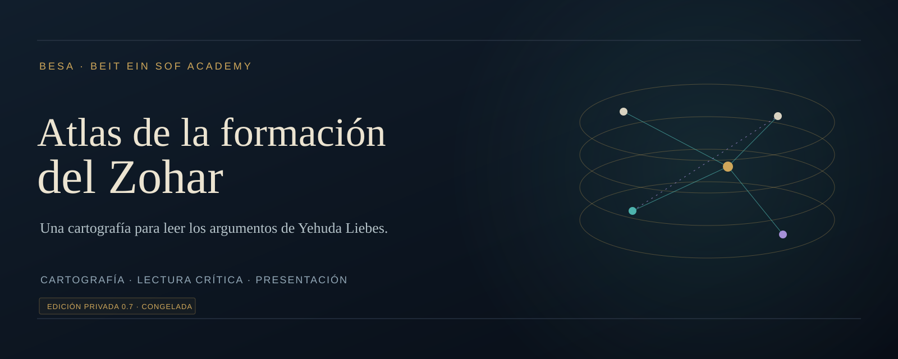

# Atlas de la formación del Zohar

**Un espacio visual para leer la estructura de un argumento histórico.**

El Atlas de la formación del Zohar organiza la hipótesis de Yehuda Liebes en una cartografía interactiva de personas, textos, tradiciones y relaciones. Cada vínculo permite seguir el testimonio, el argumento del investigador y la forma de representarlo, con sus reservas y referencias.

**BESA · Beit Ein Sof Academy**  
**Edición 0.7 · aplicación privada · versión congelada**

## Una lectura en varios planos

El proyecto combina un atlas tridimensional, una mesa de relaciones y fichas comparadas. Cinco recorridos originales ofrecen entradas al argumento; el lector puede construir una secuencia propia, conservar preguntas en su cuaderno y convertir la lectura en una exposición.

| Dimensión | Alcance de la edición |
| --- | --- |
| Cartografía | 58 nodos, 124 vínculos y siete estratos relativos. |
| Lectura crítica | Testimonios, argumentos, alternativas, auditoría y referencias. |
| Comparación | Dos fichas alineadas para estudiar coincidencias y diferencias. |
| Trabajo personal | Cuaderno y recorridos con comentarios del lector. |
| Exposición | Presentación por pasos, texto ampliado y guion de lectura. |

## Criterio académico

La altura del atlas expresa una posición relativa dentro de la reconstrucción. Los tipos de relación y las convenciones gráficas hacen visible la diferencia entre testimonio e inferencia. Los grados A/B/C/H son una clasificación editorial BESA; las relaciones hipotéticas no representan hechos históricos demostrados.

Fuente principal: Yehuda Liebes, «How the Zohar Was Written», *Studies in the Zohar*, capítulo 2, pp. 85–138, notas pp. 193–227; traducción española BESA.

## Estado de la edición

La versión 0.7 está congelada para su conservación. La validación incluye 182 fichas y 604 vistas de campos, además de comprobaciones de navegación, referencias, enlaces y presentación en escritorio y móvil.

## Acceso

Esta es la presentación pública del proyecto. La aplicación, el código y los paquetes de descarga se conservan en un repositorio privado de su propietario. Esta página no concede acceso a esos materiales ni habilita su uso.

## Autoría y contacto

Proyecto BESA · Beit Ein Sof Academy.  
Gestión del repositorio: [Lucien1234-pixel](https://github.com/Lucien1234-pixel).

La atribución de las fuentes académicas y los derechos de sus autores se mantienen. No se otorga una licencia abierta sobre la aplicación a través de esta presentación.
